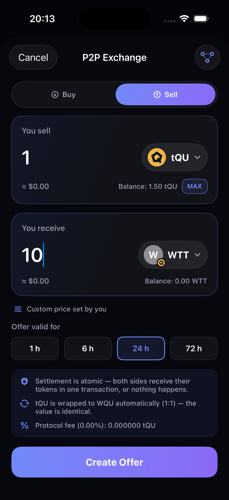
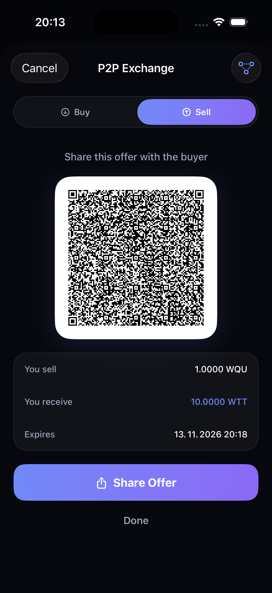
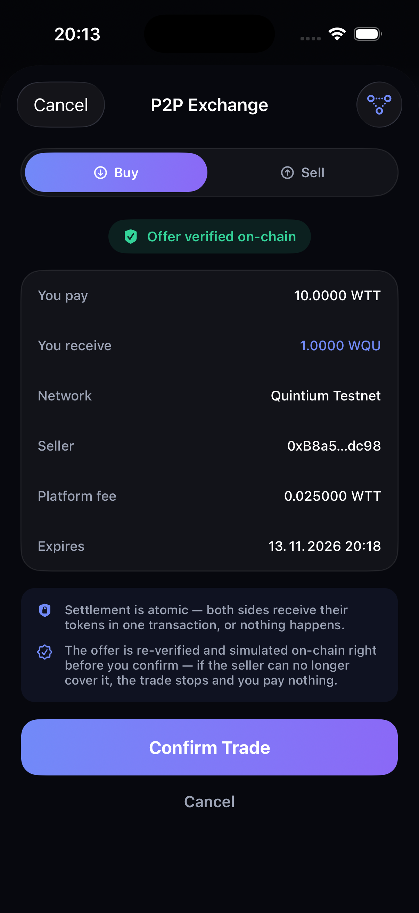
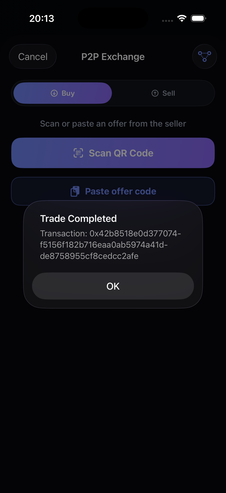
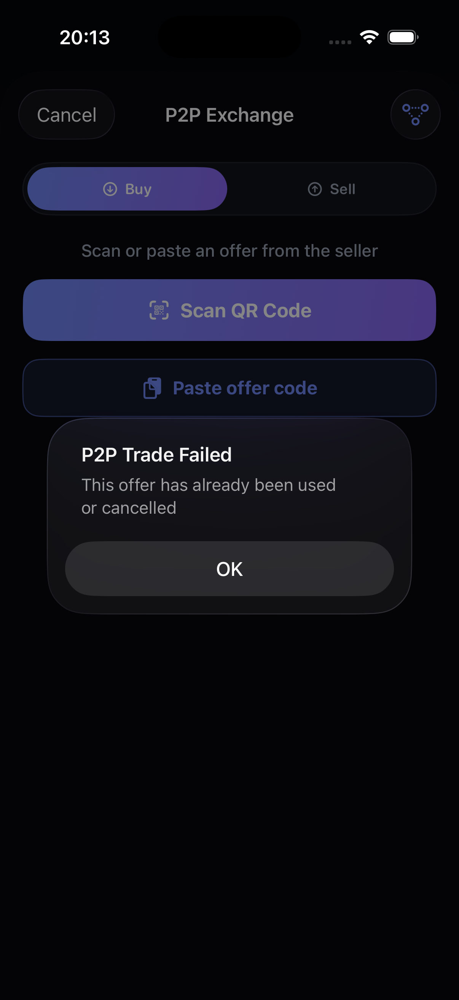
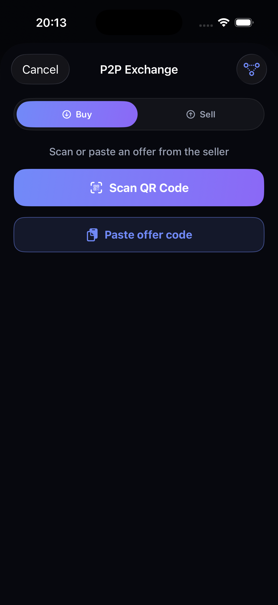
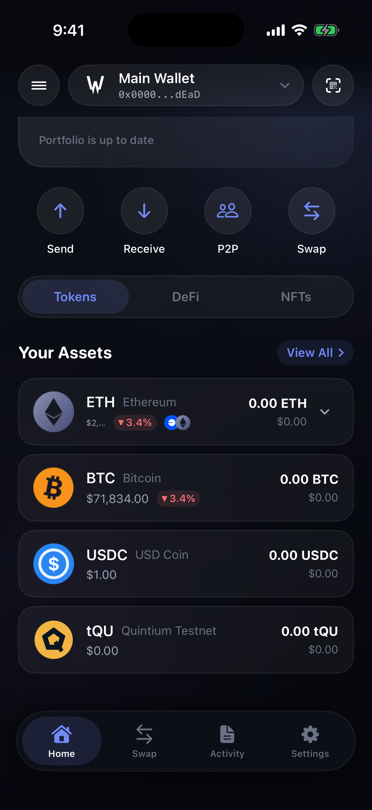
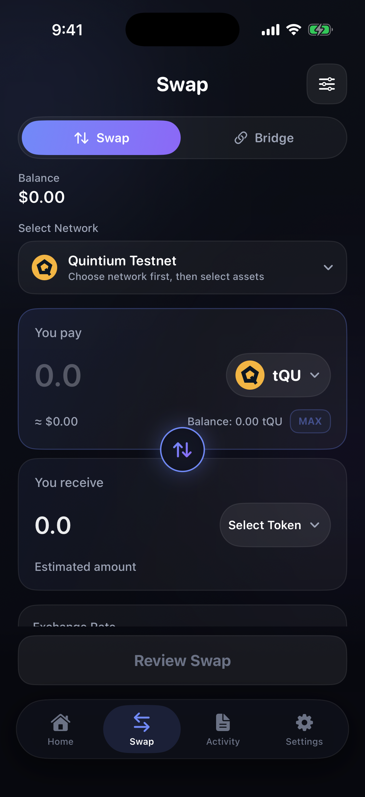
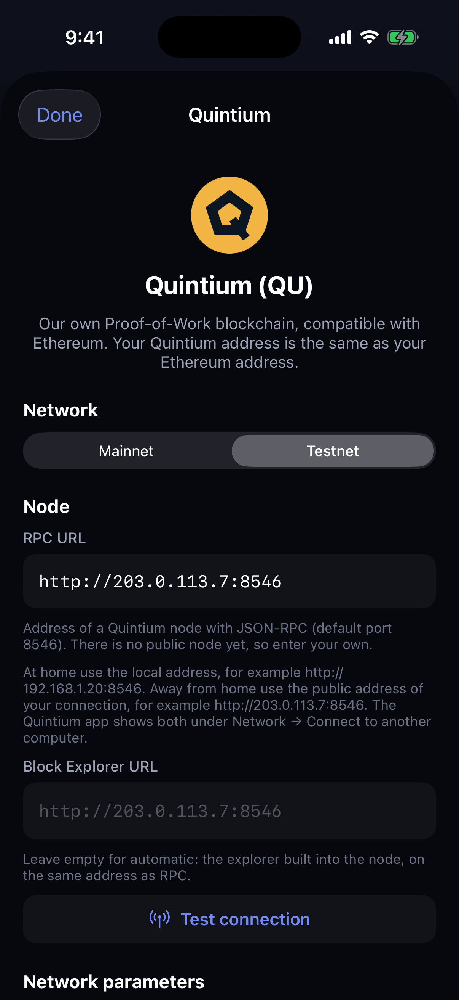

# Wpayin Wallet 1.4.0

Release details and verification status: [1.3.1 release notes](docs/release-notes/RELEASE_NOTES_v1.3.1.md).

Wpayin Wallet is a non-custodial iOS wallet built with SwiftUI and Trust
Wallet Core. It supports Bitcoin, Ethereum, Solana, Quinvium, EVM-compatible networks,
tokens, network-aware transaction history, NFTs, DEX swaps, cross-chain
bridging, and atomic EVM P2P trading.

An independently structured native Android port now lives in
[the Android repository](https://github.com/Lakylife/wpayin-erc20-android-app). Its README records
the build variants, implemented foundation, and remaining security-gated parity
work; the existing iOS target is unchanged by the Android project.

> This project has not received a professional security audit. Use test
> accounts and small amounts only. You are responsible for protecting your
> recovery phrase and private keys.

<p align="center">
  
  
  
</p>
<p align="center">
  
  
  
</p>
<p align="center">
  
  
  
</p>

The 1.3.1 P2P screenshots come from a real trade between two throwaway test
wallets on a temporary local Quintium testnet node; the 1.3.0 screenshots are
from a credential-free DEBUG fixture (`--ui-screenshot-mode`). No recovery
phrase, private key or real balance is shown.

## Version 1.4.0

- Quintium is now called **Quinvium**. Only the visible name changed: the
  coin (QU, testnet tQU), chain IDs, addresses, your node settings and saved
  data stay the same.
- Plain `http://` is blocked for every network except local addresses and
  your own Quinvium node.
- Adding a Quinvium token that is not on the network's token registry shows a
  warning.

## Version 1.3.2

- A Quintium node address starting with `http://` now works, including a
  public IP address over mobile data. User-run Quintium nodes have no TLS, and
  App Transport Security exceptions cannot name raw IP addresses, so the app
  sets `NSAllowsArbitraryLoads` in `Wpayin_Wallet/Info.plist` (merged with the
  generated Info.plist). All other networks use https.
- **Settings → Quintium** warns when the node is reached over plain http on a
  non-local address and recommends https.

## Version 1.3.1

- **P2P trading on the Quintium testnet.** Offers settle atomically through
  AirSwap SwapERC20 v4.3 at `0x60FD058c896B7E039363F07485016116f915ae02`
  (EIP-712 domain `SWAP_ERC20` / `4.3`, chain ID 52402) with a zero protocol
  fee. tQU is wrapped to WQU (`0xae00…000a`) automatically, 1:1. Mainnet has
  no P2P contract yet, so P2P stays off there; Bridge is still unavailable on
  Quintium.
- Fixed a crash when adding a custom token whose balance is above about
  9.2 tokens (18 decimals): hex balances are now converted with arbitrary
  precision.
- Custom tokens now show the balance of the active account instead of the
  balance stored when the token was added.
- The **You receive** amount in P2P Sell can be typed again (a custom price).

## Previous version 1.3.0

- Added **Quintium Swap** on the Quintium testnet. Swaps go through the
  Quintium router (`0xfee495049060F02Fc9Ef91e179fF48E8a7471E95`) with wrapped
  tQU (WAET); the native coin is selected first.
- Added Quintium to the **All Assets** network filter and to the Swap network
  list; tQU is shown as one grouped asset with its own icon.
- The block explorer address is filled in automatically from the node's RPC
  address (the explorer built into the node).
- **Settings → Quintium** explains how to reach your node away from home
  (local address at home, public IP address of your connection elsewhere).
- Bridge and P2P show a note that they are not available on Quintium yet.
- The testnet was restarted (testnet-4). The app ships no preset Quintium
  tokens; add your own with **Add Token**.

## Version 1.2.0

- Added the Quintium network (QU on mainnet, tQU on testnet): balance, sending
  and transaction history read from the node's own index (`aether_addressTxs`).
- Added **Settings → Quintium** to choose mainnet or testnet, enter your node's
  RPC and explorer URLs, and test the connection (chain ID and latest block).
- Added the Quintium QU/tQU logo across asset lists and network pickers, plus
  English and Czech translations.
- Safety guard: Quintium never falls back to an Ethereum node. Without a node
  URL no Quintium transaction is signed or sent.
- An empty or invalid RPC address now shows an error instead of crashing.
- Home asset list keeps the original token symbol case (tQU) and the correct
  network icon.

See [RELEASE_NOTES_v1.2.0.md](docs/release-notes/RELEASE_NOTES_v1.2.0.md) for details.

## Quinvium network

Quinvium is an EVM-compatible Proof-of-Work chain that
uses Ethereum keys and addresses (`m/44'/60'/0'/0`), so your Quinvium address is
the same as your Ethereum address.

| Network | Chain ID | Currency | Default RPC port |
| --- | --- | --- | --- |
| Quinvium Mainnet | 52401 | QU (18 decimals) | 8545 |
| Quinvium Testnet | 52402 | tQU (18 decimals) | 8546 |

- There is no public Quinvium RPC node yet. Run your own node and enter its URL
  in **Settings → Quinvium** (or set `QUINTIUM_RPC_URL` /
  `QUINTIUM_TESTNET_RPC_URL` and the optional `QUINTIUM_EXPLORER_URL` /
  `QUINTIUM_TESTNET_EXPLORER_URL` as scheme environment variables).
- The testnet is running now; mainnet starts on 1 January 2027 (00:00 UTC).
- QU has no market price yet, so fiat values for Quinvium show $0.00.
- On the testnet, Swap uses the Quinvium router and P2P uses AirSwap
  SwapERC20 v4.3 at `0x60FD058c896B7E039363F07485016116f915ae02` (zero
  protocol fee, tQU auto-wrapped to WQU). Neither is deployed on mainnet yet.

## Version 1.1.10

- Added fresh device authentication for recovery-phrase and private-key export.
- Limited secret clipboard copies to this device with a 30-second expiry.
- Corrected Auto-Lock timing and active-account private-key export.
- Prevented delayed balance, history and NFT responses from changing another wallet.
- Improved fee-aware swap/bridge flows, P2P review, asset lists and notification settings.

The simulator build and unit tests pass. On-device authentication checks remain manual.

See [RELEASE_NOTES_v1.1.10.md](docs/release-notes/RELEASE_NOTES_v1.1.10.md) for details.

## Version 1.1.9

- Redesigned Deposit, Withdraw, asset details, Swap, Bridge, and multi-network
  transaction history for clearer network-aware wallet flows.
- Added Request Payment QR/links and optional WalletConnect support with
  explicit proposal, signature, and transaction review.
- Added fee-aware Max calculations, route/status tracking, Face ID protection
  for transaction signing, and selectable time zones.
- Added custom-token discovery and removal controls, P2P improvements, and a
  disclosed application-development fee for supported outgoing operations.
- Added NFT spam protection with provider filtering, conservative local
  detection, a reviewable hidden folder, and manual hide/restore controls.
- Expanded the in-app Help Center and added a selectable version history under
  About, covering releases 1.1.0 through 1.1.9.
- Refined and slightly extended the launch experience without restoring the
  previous dark backing behind the logo.

See [RELEASE_NOTES_v1.1.9.md](docs/release-notes/RELEASE_NOTES_v1.1.9.md) for the complete
release notes.

## Requirements

- macOS with Xcode 16 or newer
- iOS 15.0 or newer
- An Apple development team for installation on a physical device

## Build and run

```bash
git clone https://github.com/Lakylife/wpayin-erc20-ios-app.git
cd wpayin-erc20-ios-app
open Wpayin_Wallet.xcodeproj
```

Xcode resolves the pinned Swift Package Manager dependencies automatically.
Select the `Wpayin_Wallet` scheme, choose an iPhone simulator, and press
`Cmd-R`.

The command-line equivalent is:

```bash
xcodebuild \
  -project Wpayin_Wallet.xcodeproj \
  -scheme Wpayin_Wallet \
  -destination 'generic/platform=iOS Simulator' \
  CODE_SIGNING_ALLOWED=NO \
  build
```

No configuration file needs to be copied or created. Public RPC endpoints and
keyless services provide the base wallet functionality.

## Optional API integrations

NFT discovery and indexed transaction history use optional third-party API
keys. In Xcode, open **Product → Scheme → Edit Scheme → Run → Arguments** and
add the required values under **Environment Variables**:

| Variable | Purpose |
| --- | --- |
| `ALCHEMY_API_KEY` | Ethereum NFT discovery |
| `ETHERSCAN_API_KEY` | Indexed EVM transaction history |
| `COINGECKO_API_KEY` | Optional authenticated CoinGecko access |
| `P2P_BOARD_URL` | Optional public P2P board endpoint |
| `P2P_BOARD_ANON_KEY` | Optional public P2P board client key |
| `PLATFORM_FEE_RECIPIENT` | Optional EVM platform-fee treasury address |

The app still builds and runs when these values are absent. Missing provider
keys disable only their corresponding optional data. Do not add credentials,
treasury addresses, or environment files to source control. Any value supplied
to an iOS application at runtime can still be extracted, so production
deployments should use restricted keys or a server-side proxy.

## Optional public P2P offer board

P2P offers can be public (discoverable by every app user) or private (shared
only by QR/code). The optional public board uses a separately configured
Supabase/PostgREST deployment; setup is documented in
[`docs/P2P_OFFER_BOARD.md`](docs/P2P_OFFER_BOARD.md). Private QR/code trading
continues to work when the board is not configured.

## Supported networks

- Bitcoin (Native SegWit/BIP84)
- Ethereum
- Solana
- BNB Chain
- Polygon
- Arbitrum
- Optimism
- Avalanche C-Chain
- Base
- Quinvium (mainnet and testnet; requires your own node, see above)

Cross-chain bridging is available between the supported EVM networks listed
above through LI.FI. LI.FI does not support Quinvium, so Quinvium is not
available for bridging. Native Bitcoin and Solana cannot participate in atomic
EVM P2P settlement; supported wrapped representations include WBTC, cbBTC,
BTCB, and BTC.b where available.

## Project layout

```text
Wpayin_Wallet/
├── Assets.xcassets/
├── Core/
│   ├── API/
│   ├── Config/
│   ├── Managers/
│   └── Services/
├── Models/
├── Resources/
└── Views/
Wpayin_WalletTests/
Wpayin_WalletUITests/
```

The project pins WalletCore, web3swift, CryptoSwift, BigInt, and secp256k1 in
`Package.resolved`.

## Security

- Recovery phrases and private keys are stored in the iOS Keychain with
  `kSecAttrAccessibleWhenUnlockedThisDeviceOnly`.
- App lock supports Face ID, Touch ID, and device-passcode fallback.
- Sensitive wallet data must never be committed, logged, or included in
  screenshots.
- Review [SECURITY.md](SECURITY.md) before using or modifying transaction and
  key-management code.

To report a vulnerability, use a private GitHub security advisory rather than
a public issue.

## License

Released under the [MIT License](LICENSE).
